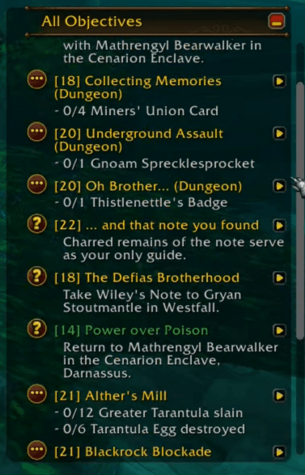

# ObjectiveScroll

  

> **AI Disclaimer**
> This addon and its documentation were made with the help of AI. It has been played with and tested in WoW Forever, but it may not work perfectly in every situation. If something looks wrong, you can turn it off at any time from the addon's settings page.

ObjectiveScroll lets you scroll through your quest list in World of Warcraft: Forever.

Normally, your quest list only shows as many quests as it can fit within the panel. With ObjectiveScroll, the panel contains every quest you are tracking, and you can scroll through them.

  

## Features

- See all of your tracked quests
- Scroll with your mouse wheel, or drag the scroll bar
- Smooth scrolling
- Configurable scrollbar width and color
- Type `/oscroll config` to open the settings page

## Download

- **CurseForge:** [ObjectiveScroll on CurseForge](https://www.curseforge.com/wow/addons/objectivescroll)
- **GitHub:** [Releases page](https://github.com/1nderr/wow-objective-scroll/releases)
